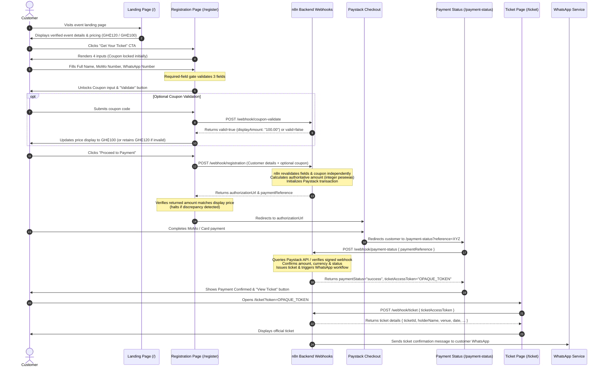

# SPLASH & VIBEZ — Implementation Plan & Phase Guide

## 1. Project Inspection & Technology Stack

### 1.1 Existing Project State
- **Workspace Structure**: Clean, modular React 18 + Vite + TypeScript application in root workspace.
- **Specification Source of Truth**: `splash-vibez-ide-instructions/` (`PROJECT_SPECIFICATION.md`, `FRONTEND_REQUIREMENTS.md`, `DESIGN_GUIDELINES.md`, `N8N_INTEGRATION.md`, `AGENTS.md`).
- **Environment**: Node.js `v24.19.0` and npm `11.17.0`.

### 1.2 Selected Technology Stack
- **Build Tool & Bundler**: Vite 6 (React + TypeScript)
- **Framework**: React 18 with TypeScript in strict mode
- **Routing**: `react-router-dom`
- **Styling**: Tailwind CSS + custom night-event design tokens (`#080C14` dark foundation, `#131D31` card surfaces, `#00E5FF` cyan & `#F43F5E` coral accents)
- **Icons**: `lucide-react`
- **Testing**: Vitest + React Testing Library + `@testing-library/jest-dom`
- **Linting & Code Quality**: TypeScript strict compiler checks (`tsc --noEmit`)

---

## 2. Customer Registration & Payment Journey Architecture

---

## 3. Implementation Status Checklist

### Phase 1: Foundation Setup & Project Scaffolding
- [x] Initialize Vite + React + TypeScript in workspace root.
- [x] Configure Tailwind CSS with design tokens (dark night theme, cyan/coral accents, typography, container widths).
- [x] Install dependencies (`react-router-dom`, `lucide-react`, `@testing-library`, `vitest`).
- [x] Set up environment variable typing (`vite-env.d.ts`) and create `.env.example` & `.env`.
- [x] Configure routing in `src/App.tsx` for `/`, `/register`, `/payment-status`, `/ticket`, and `*`.

### Phase 2: Design Tokens, Layout & Landing Page
- [x] Build shared UI components: `Button`, `InputField`, `Alert`, `Spinner`, `Header`, `Footer`.
- [x] Build `EventHero` and `EventDetails` containing confirmed details:
  - Event: SPLASH & VIBEZ
  - Venue: Triple Hill Hotel
  - Date: Saturday, 12 December 2026
  - Time: 8:00 PM – 3:00 AM
  - Price: GH₵120 standard / GH₵100 with valid coupon
- [x] Wire `/` route with clear CTA leading to `/register`.

### Phase 3: Ghanaian Phone Formatting & Registration Form Core
- [x] Implement `src/utils/phone.ts` validating Ghana phone numbers (`0XXXXXXXXX`, `+233XXXXXXXXX`) and normalizing to E.164 (`+233XXXXXXXXX`).
- [x] Implement `RegistrationForm` with 4 inputs: Full Name, MoMo Number, WhatsApp Number, Coupon Code.
- [x] Implement the **Required-Field Gate**: Coupon input and Validate button remain disabled until the first three fields pass validation.
- [x] Maintain separate, independent state for MoMo Number and WhatsApp Number (no auto-copying).

### Phase 4: Coupon Validation & Price Summary
- [x] Implement `CouponValidator` component with explicit state machine (`locked`, `idle`, `validating`, `valid`, `invalid`, `error`).
- [x] Implement `PriceSummary` displaying default GH₵120, and GH₵100 with GH₵20 discount only when confirmed valid.
- [x] Reset coupon state to `idle` and restore price to GH₵120 immediately if coupon code is edited or erased.
- [x] Clear action button to conveniently wipe input and reset state to `idle`.
- [x] Ensure blank coupon allows proceeding at GH₵120 without calling validation webhook.

### Phase 5: n8n Integration & Payment Initialization
- [x] Implement `src/services/n8nApi.ts` for all 4 endpoints with full TypeScript types, timeout controls, runtime validation, and error handling.
- [x] Implement registration submission:
  - Submits customer details and optional coupon.
  - Receives `authorizationUrl`, `paymentReference`, and authoritative amount.
  - Price check: halts and requests customer confirmation if server amount differs from displayed amount.
  - Redirects customer to Paystack checkout on match.
  - Never simulates payment or displays "Payment successful" at registration.

### Phase 6: Authoritative Payment Status & Ticket Retrieval
- [x] Implement `PaymentStatus` page:
  - Extracts `reference` from Paystack return URL.
  - Queries `VITE_N8N_PAYMENT_STATUS_URL` (never trusts URL parameters as proof).
  - Renders pending (with re-check button), failure, or success states.
  - Stores `ticketAccessToken` securely in memory/navigation state on success.
- [x] Implement `Ticket` page:
  - Requires `ticketAccessToken`.
  - Queries `VITE_N8N_TICKET_URL` for verified ticket data.
  - Renders ticket card with event details, ticket ID, and holder name.
  - Hides sensitive customer phone numbers or Paystack references.
  - Explicitly lacks any public ticket verification route.

### Phase 7: Verification, Automated Tests & Build
- [x] Unit test suites across 6 test files covering phone validation, required-field gate, coupon state machine, API clients, and payment/ticket display.
- [x] `npm run lint` & `npm run typecheck` passed (0 errors).
- [x] `npm test` passed (33/33 tests passing).
- [x] `npm run build` passed (production bundle generated cleanly in `dist/`).
- [x] Root `README.md` created with complete deployment and run instructions.
